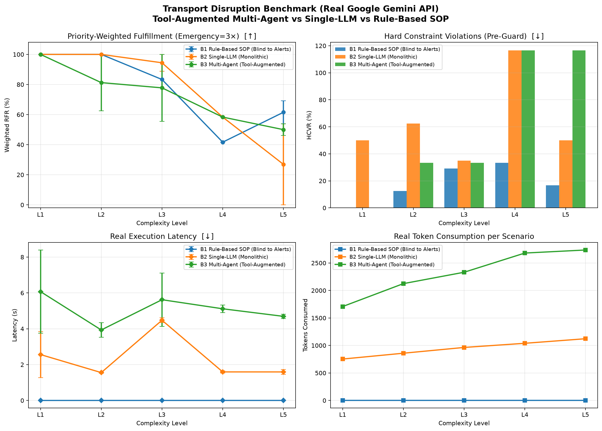

# Real Gemini API Benchmark Results

## Experimental Configuration
- **Network:** 4×4 Manhattan urban grid (16 nodes, 24 edges with capacities and travel times).
- **Complexity Spectrum:** L1 to L5 graduated scenarios.
- **Unstructured Text Advisories:** Tested on police/traffic incident alerts that rule-based SOPs cannot parse.
- **Controllers Evaluated:**
  1. `B1_RuleBased`: Rigid classical Dijkstra SOP (blind to natural language alerts).
  2. `B2_SingleLLM`: Monolithic Gemini call with full context.
  3. `B3_MultiAgent`: 4-Agent collaborative system (Traffic, Fleet, Routing Tool, Coordinator).
- **Foundation Model:** `gemini-flash-lite-latest` via Google GenAI SDK.

### Priority-Weighted Fulfillment Rate (RFR_w %)

| Level | B1 Rule-Based SOP | B2 Single-LLM | B3 Multi-Agent |
| :---: | :---: | :---: | :---: |
| L1 | 100.0 ± 0.0 | 100.0 ± 0.0 | 100.0 ± 0.0 |
| L2 | 100.0 ± 0.0 | 100.0 ± 0.0 | 81.2 ± 18.8 |
| L3 | 83.3 ± 5.6 | 94.4 ± 5.6 | 77.8 ± 22.2 |
| L4 | 41.7 ± 0.0 | 58.3 ± 0.0 | 58.3 ± 0.0 |
| L5 | 61.5 ± 7.7 | 26.9 ± 26.9 | 50.0 ± 3.8 |

### Standard Request Fulfillment Rate (RFR %)

| Level | B1 Rule-Based SOP | B2 Single-LLM | B3 Multi-Agent |
| :---: | :---: | :---: | :---: |
| L1 | 100.0 ± 0.0 | 100.0 ± 0.0 | 100.0 ± 0.0 |
| L2 | 100.0 ± 0.0 | 100.0 ± 0.0 | 87.5 ± 12.5 |
| L3 | 70.0 ± 10.0 | 90.0 ± 10.0 | 80.0 ± 20.0 |
| L4 | 50.0 ± 0.0 | 50.0 ± 0.0 | 50.0 ± 0.0 |
| L5 | 42.9 ± 0.0 | 21.4 ± 21.4 | 35.7 ± 7.1 |

### Hard Constraint Violation Rate (HCVR %)

| Level | B1 Rule-Based SOP | B2 Single-LLM | B3 Multi-Agent |
| :---: | :---: | :---: | :---: |
| L1 | 0.0 ± 0.0 | 50.0 ± 16.7 | 0.0 ± 0.0 |
| L2 | 12.5 ± 12.5 | 62.5 ± 12.5 | 33.3 ± 33.3 |
| L3 | 29.2 ± 4.2 | 35.0 ± 15.0 | 33.3 ± 33.3 |
| L4 | 33.3 ± 33.3 | 116.7 ± 16.7 | 116.7 ± 16.7 |
| L5 | 16.7 ± 16.7 | 50.0 ± 50.0 | 116.7 ± 16.7 |

### Real Execution Latency (seconds)

| Level | B1 Rule-Based SOP | B2 Single-LLM | B3 Multi-Agent |
| :---: | :---: | :---: | :---: |
| L1 | 0.0 ± 0.0 | 2.6 ± 1.3 | 6.1 ± 2.3 |
| L2 | 0.0 ± 0.0 | 1.6 ± 0.0 | 3.9 ± 0.4 |
| L3 | 0.0 ± 0.0 | 4.5 ± 0.1 | 5.6 ± 1.5 |
| L4 | 0.0 ± 0.0 | 1.6 ± 0.1 | 5.1 ± 0.2 |
| L5 | 0.0 ± 0.0 | 1.6 ± 0.1 | 4.7 ± 0.1 |

### Total Tokens Consumed

| Level | B1 Rule-Based SOP | B2 Single-LLM | B3 Multi-Agent |
| :---: | :---: | :---: | :---: |
| L1 | 0 | 753 | 1708 |
| L2 | 0 | 859 | 2124 |
| L3 | 0 | 964 | 2332 |
| L4 | 0 | 1040 | 2680 |
| L5 | 0 | 1122 | 2736 |

### Real API Monetary Cost ($)

| Level | B1 Rule-Based SOP | B2 Single-LLM | B3 Multi-Agent |
| :---: | :---: | :---: | :---: |
| L1 | $0.000000 | $0.000155 | $0.000321 |
| L2 | $0.000000 | $0.000173 | $0.000410 |
| L3 | $0.000000 | $0.000205 | $0.000447 |
| L4 | $0.000000 | $0.000220 | $0.000520 |
| L5 | $0.000000 | $0.000222 | $0.000491 |

## Embedded Plot

